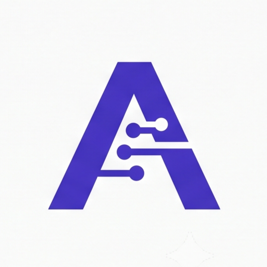

# PharmAssist: Enterprise AI-Powered Quality Management System (QMS)

<p align="center">
  
</p>

<p align="center">
  <b>Next-Generation Regulatory Complaint Intelligence, Multi-Agent Cognitive Intake, and GxP Compliance for Pharmaceutical Manufacturers</b>
</p>

<p align="center">
  
  
  
  
  
  
  
  
</p>

---

## Executive Overview

**PharmAssist** is an enterprise-grade Quality Management System (QMS) designed specifically for Pharmaceutical Active Pharmaceutical Ingredient (API) and Finished Dosage Form (FDF) manufacturing facilities. 

In regulated pharmaceutical production, complaint intake is fraught with high compliance risk, data fragmentation, and time-intensive manual transcription. PharmAssist replaces tedious manual entry with an intelligent, multi-node **LangGraph AI Copilot**. Quality Assurance (QA) officers simply paste unstructured complaint narratives, upload scanned documents, or drop PDF/email reports; the copilot parses GxP attributes, scores batch severity, assesses regulatory reportability (USFDA / MHRA / WHO-GMP), cross-checks historical batches for duplicates, and generates suggested CAPA (Corrective and Preventive Actions) with immutable audit traceability.

---

## Architecture & Data Flow

PharmAssist is built with a strictly decoupled architecture: a high-performance **FastAPI** asynchronous ASGI backend orchestrating an intelligent **LangGraph StateGraph**, coupled to a modern **React + Vite** single-page application with Redux Toolkit state persistence.

```
┌────────────────────────────────────────────────────────┐        ┌──────────────────────────────────────────────────────────────────┐
│                    REACT FRONTEND                      │        │                         FASTAPI BACKEND                          │
│             (TypeScript + Vite + Redux)                │        │                   (Python 3.11 + Async ASGI)                     │
│                                                        │  HTTP  │                                                                  │
│  ┌─────────────────────────┐  ┌─────────────────────┐  │◄──────►│  ┌───────────────────────────┐  ┌─────────────────────────────┐  │
│  │ Complaint Ledger & Form │  │ AI Copilot Panel    │  │ Axios  │  │ API Routers (/api/v1)     │──►│ Business Services Layer     │  │
│  │ (Controlled Redux State)│  │ (Live Chat & Upload)│  │  JSON  │  │ (Auth, Complaints, Copilot│  │ (Validation, QMS Logic,     │  │
│  └───────────┬─────────────┘  └──────────┬──────────┘  │        │  │  Dashboard, Health)       │  │  Session Persistence)        │  │
│              │                           │             │        │  └───────────────────────────┘  └──────────────┬──────────────┘  │
│              └─────────────┬─────────────┘             │        │                                                │                 │
│                            │                           │        │                         ┌──────────────────────▼──────────────┐  │
│             ┌──────────────▼──────────────┐            │        │                         │ Repositories Layer (SQLAlchemy 2.0) │  │
│             │ Redux Toolkit Single Source │            │        │                         └──────────────────────┬──────────────┘  │
│             │ of Truth (Session-Gated)    │            │        │                                                │                 │
│             └─────────────────────────────┘            │        │                                       ┌────────▼───────┐         │
│                                                        │        │                                       │ PostgreSQL /   │         │
│                                                        │        │                                       │ SQLite Engine  │         │
│                                                        │        │                                       └────────────────┘         │
│                                                        │        │                                                                  │
│                                                        │        │  ┌────────────────────────────────────────────────────────────┐  │
│                                                        │        │  │               LANGGRAPH MULTI-NODE ENGINE                  │  │
│                                                        │        │  │                                                            │  │
│                                                        │        │  │  [Intent Detect] ──► [Input Parser / OCR]                  │  │
│                                                        │        │  │         │                                                  │  │
│                                                        │        │  │         ├──► [Extraction / Update Node]                    │  │
│                                                        │        │  │         │         │                                        │  │
│                                                        │        │  │         │         ▼                                        │  │
│                                                        │        │  │         │    [Completeness & GxP Validation]               │  │
│                                                        │        │  │         │         │                                        │  │
│                                                        │        │  │         │         ▼                                        │  │
│                                                        │        │  │         │    [Duplicate Candidate Matching]                │  │
│                                                        │        │  │         │         │                                        │  │
│                                                        │        │  │         │         ▼                                        │  │
│                                                        │        │  │         │    [Severity & Risk Assessment (ICH Q9)]         │  │
│                                                        │        │  │         │         │                                        │  │
│                                                        │        │  │         │         ▼                                        │  │
│                                                        │        │  │         │    [CAPA & Root Cause Recommendation]            │  │
│                                                        │        │  │         │         │                                        │  │
│                                                        │        │  │         │         ▼                                        │  │
│                                                        │        │  │         ├──► [Conversation / General Query]                │  │
│                                                        │        │  │         │         │                                        │  │
│                                                        │        │  │         ▼         ▼                                        │  │
│                                                        │        │  │    [Response Formatter Envelope] ──► Structured Output     │  │
│                                                        │        │  └─────────────────────────────────────┬──────────────────────┘  │
│                                                        │        │                                        │                         │
│                                                        │        │                           ┌────────────▼────────────┐            │
│                                                        │        │                           │ Groq API Inference      │            │
│                                                        │        │                           │ (llama-3.3-70b / 8b)    │            │
│                                                        │        │                           └─────────────────────────┘            │
└────────────────────────────────────────────────────────┘        └──────────────────────────────────────────────────────────────────┘
```

---

## Core Capabilities

### 1. Multi-Modal Document & Narrative Ingestion
- Ingest customer complaints from raw pasted text, forwarded customer service emails, batch inspection sheets, or PDF documents (`pdfplumber` & `pypdf` extraction).
- Optional image OCR pipeline for packaging photos, blister pack labels, and lab certificates.

### 2. High-Precision GxP Field Extraction
Automatically extracts, structures, and cross-validates 10+ core manufacturing fields:
- **Product Identification**: Brand name, generic API, dosage form, strength/grade.
- **Batch Traceability**: Lot/Batch number, manufacturing date, expiry date, affected pack count.
- **Manufacturing Context**: Facility site block, production line, Non-Product Material (NPM) impact.
- **Defect Categorization**: Contamination, sub-potency, discoloration, dissolution failure, packaging integrity, labeling errors.

### 3. Algorithmic Risk Assessment & Severity Classification (ICH Q9)
- Standardized **Amber / Red / Green** severity traffic-light scoring (**Critical**, **Major**, **Minor**).
- Computes health hazard impact, product recall likelihood, and statutory reporting urgency (e.g. USFDA 15-Day Alert Reports, MHRA defect alerts).
- Generates targeted root-cause hypotheses and preliminary Corrective and Preventive Action (CAPA) plans.

### 4. Batch Duplicate Detection Engine
- Cross-references incoming complaints against historical ledger records using exact lot matching and normalized string similarity.
- Flags recurring batch anomalies to alert QA before duplicate investigation files are opened.

### 5. Multi-Turn Conversational Refinement
- Interactive chat loop enables QA officers to make conversational edits (*"Change the affected quantity to 4,500 vials and recompute risk"*).
- The AI dynamically executes field modifications, re-evaluates completeness, recalculates risk scores, and updates the form in real time with subtle visual highlight animations.

### 6. Clinical Command Palette & Quick Navigation
- **Command Palette (`Cmd/Ctrl + K`)**: Instantly jump between complaints, search records by batch ID, trigger new intakes, toggle dark/light theme, or launch system settings.
- **One-Click CSV Export**: Export filtered complaint logs directly for management reviews and regulatory submissions.

### 7. 21 CFR Part 11 & EU GMP Annex 11 Compliance
- Field-level immutable audit logging recording actor (Human QA Officer vs. AI Copilot), timestamp (UTC), previous value, and updated value.
- Session persistence (`copilot_sessions`) tracks multi-turn draft state without data loss across browser reloads.

---

## Technology Stack

| Domain | Technologies |
|---|---|
| **Backend Framework** | Python 3.11, FastAPI (Asynchronous ASGI), Uvicorn |
| **AI & Agentic Orchestration** | LangGraph 0.2+, LangChain Core, Groq API (`llama-3.3-70b-versatile`, `llama-3.1-8b-instant`) |
| **Data Validation & ORM** | Pydantic v2, SQLAlchemy 2.0 (Async), Alembic |
| **Databases** | PostgreSQL 15 (Docker / Production), SQLite with `aiosqlite` (Zero-Config Local Dev) |
| **Frontend Framework** | React 18/19, Vite, TypeScript |
| **State Management** | Redux Toolkit (Session-Gated Store & Custom Typed Hooks) |
| **Styling & Design System** | Tailwind CSS 3.4, Vanilla CSS Custom Design Tokens, Lucide Icons |
| **Data Visualizations** | Recharts (Severity Donut Charts, Monthly Defect Trends) |
| **Containerization & CI** | Docker, Docker Compose, GitHub Actions (`.github/workflows/ci.yml`) |

---

## Directory Structure

```text
pharmassist/
├── backend/
│   ├── app/
│   │   ├── api/                 # REST endpoints (auth, complaints, copilot, dashboard, health)
│   │   ├── core/                # Settings, JWT security, DB session dependencies, logging
│   │   ├── db/                  # SQLAlchemy Base model & async session engine
│   │   ├── langgraph/           # 10-node state graph workflow & TypedDict state definitions
│   │   │   ├── nodes/           # Intent, parsing, extraction, validation, risk, CAPA, formatting
│   │   │   └── graph.py         # Compiled StateGraph workflow with conditional routing
│   │   ├── models/              # SQLAlchemy ORM models (Complaint, AIAnalysis, AuditLog, CopilotSession)
│   │   ├── repositories/        # Asynchronous DB queries, search, and duplicate matching
│   │   ├── schemas/             # Pydantic v2 request/response contracts
│   │   ├── services/            # QMS business logic, AI orchestration, dashboard analytics
│   │   └── utils/               # PDF parsing, email parsing, OCR, Groq LLM retry client
│   ├── tests/                   # Pytest suite (API endpoints, regression suite, node checks)
│   ├── Dockerfile               # Backend production container
│   ├── requirements.txt         # Production dependencies
│   └── requirements-dev.txt     # Test & development dependencies
├── frontend/
│   ├── src/
│   │   ├── app/                 # Redux store & typed hooks
│   │   ├── components/          # Shared UI (CommandMenu, Button, charts, modals)
│   │   ├── features/            # Feature slices (authSlice, complaintSlice, chatSlice, themeSlice)
│   │   ├── pages/               # Dashboard, Complaints, Copilot, Detail, Settings, SplashScreen
│   │   ├── routes/              # AppShell navigation & protected route gate
│   │   └── lib/                 # Axios client, CSV export utility, formatters
│   ├── Dockerfile               # Frontend production container
│   ├── package.json             # NPM package manifest
│   └── vite.config.ts           # Vite bundler configuration & /api proxy
├── sample_complaints/           # Sample pharmaceutical complaint test PDFs
├── .github/workflows/ci.yml     # Automated CI verification workflow
├── docker-compose.yml           # Multi-container orchestration (DB, API, Frontend)
├── Makefile                     # Developer productivity shortcuts
├── ARCHITECTURE_pharmassist.md  # Detailed architectural specification & data flow
├── DESIGN_SYSTEM.md             # UI design tokens & styling guide
└── PROJECT_AUDIT.md             # Comprehensive engineering audit & verification log
```

---

## Quickstart & Local Setup

### Prerequisites
- **Node.js**: v18+ & npm
- **Python**: v3.11+
- **Docker & Docker Compose** (Optional, for full containerized stack)
- **Groq API Key** (Optional; intelligent mock fallbacks handle local development without an API key)

---

### Option A: Standard Local Setup (Fastest)

#### 1. Backend Service
```bash
cd backend

# Create and activate virtual environment
python -m venv venv
# On Windows:
venv\Scripts\activate
# On macOS/Linux:
source venv/bin/activate

# Install dependencies
pip install -r requirements.txt

# Configure environment
cp ../.env.example .env
# Edit backend/.env to add your GROQ_API_KEY (optional) and configure DATABASE_URL
# Default local SQLite: DATABASE_URL=sqlite+aiosqlite:///./pharmassist.db

# Launch FastAPI development server
uvicorn app.main:app --reload --port 8000
```
> The API will be live at `http://localhost:8000`. Interactive OpenAPI documentation is available at `http://localhost:8000/docs`.

#### 2. Frontend Application
```bash
# In a new terminal, navigate to frontend
cd frontend

# Install dependencies
npm install

# Start Vite development server
npm run dev
```
> The application will launch at `http://localhost:5174` (or `http://localhost:5173`).

---

### Option B: Docker Compose (Full Stack)

To run the complete stack with PostgreSQL, FastAPI, and the React frontend in containers:

```bash
# From the repository root
docker compose up --build
```

- **Frontend**: `http://localhost:5173`
- **Backend API**: `http://localhost:8000`
- **PostgreSQL**: `localhost:5432`

---

## Demo Credentials & Access

PharmAssist includes auto-seeding demo accounts to explore all QMS features out of the box:

- **Quick Login**: Simply click **"Continue as Demo User"** on the login screen.
- **Manual Credentials**:
  - **QA Officer**: `demo@pharmassist.com` / `demo123`
  - **QA Director**: `admin@pharmassist.com` / `admin123`
- Pre-loaded with 15 realistic GxP pharmaceutical complaint records across API & Finished Dosage products.

---

## Verification & Test Suite

The repository includes a comprehensive, isolated regression and integration test suite:

```bash
cd backend
pip install -r requirements-dev.txt

# Run all backend regression and node tests
pytest -v
```

- Tests run against isolated in-memory SQLite instances.
- Zero external network dependencies (LLM calls are mock-tested for deterministic assertion).
- Covers multi-turn session persistence, audit rollback, latest-version dashboard analytics, input validation, and unauthorized route access.

To verify frontend build and linting:
```bash
cd frontend
npm run lint
npm run build
```

---

## Regulatory Standards Reference

PharmAssist was engineered with reference to international quality and data integrity regulations:
- **USFDA 21 CFR Part 211**: Current Good Manufacturing Practice for Finished Pharmaceuticals (Complaint handling, § 211.198).
- **USFDA 21 CFR Part 11**: Electronic Records; Electronic Signatures (Audit trails, system validation, operational controls).
- **EU GMP Volume 4 Annex 11**: Computerised Systems.
- **ICH Q9 (R1)**: Quality Risk Management principles for severity evaluation and regulatory reporting determination.
- **ICH Q10**: Pharmaceutical Quality System lifecycle management.

---

<p align="center">
  <b>PharmAssist</b> — Enterprise Quality Management System & Regulatory Intelligence Platform
</p>
